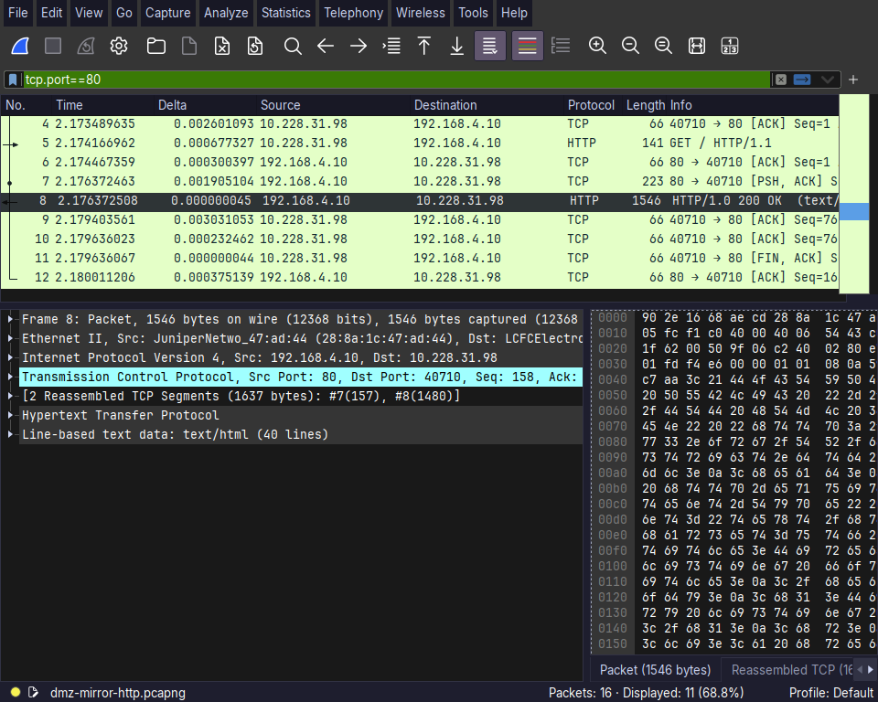
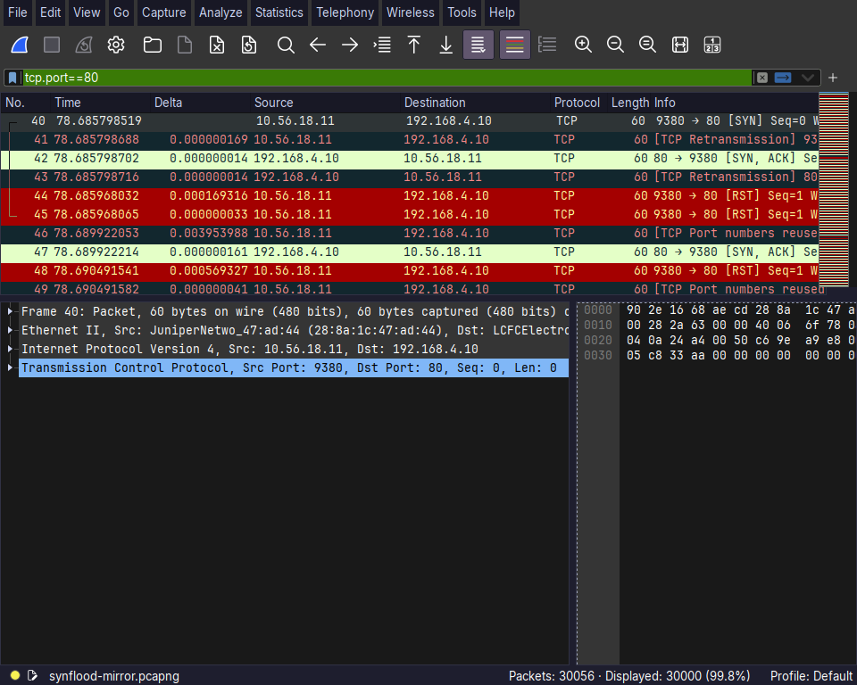

# Assignment 35 – SRX port mirroring og IDS (Snort)

Konfiguration til SRX240 i JSON: `r1-config.json`. Bygger videre på [Assignment 34](https://github.com/mwsk75996/ass34network) med de samme porte, VLANs, adresser og NAT.

## Routeren

- **R1 / SRX-C1** – samme opsætning som i Assignment 34. To interne L2-VLANs (`mySwitch2Vlan` til USERLAN og `mySwitch1Vlan` til DMZ). De routede porte ge-0/0/1 og ge-0/0/2 er patchet ind i hvert sit VLAN. DHCP på USERLAN, source NAT mod LabLan og destination NAT fra `10.56.16.85:80` til webserveren `192.168.4.10:80`.
- **Port mirroring (nyt):** Al IPv4-trafik ind og ud af ge-0/0/2 (DMZ-gatewayen) kopieres ud på ge-0/0/4. Det sker med firewall-filteret `my-port-filter`, som sidder både som `input` og `output` på ge-0/0/2 og har handlingen `port-mirror`. `forwarding-options port-mirroring` sender kopierne ud af ge-0/0/4 til next-hop `2.2.2.1`, som er PC4.
- **PC4 (nyt):** Linux-laptop på MonitorLan `2.2.2.0/24`. Den kører Wireshark til at se den spejlede trafik og Snort som netværksbaseret IDS.
- **Zoner:** USERLAN er trust-zonen, untrust er LabLan, DMZ er webserveren, og MONITOR er ny til ge-0/0/4. MONITOR har ingen policies, så PC4 kan ikke sende noget videre gennem routeren. Den kan kun pinge ge-0/0/4.

### Hvad er port mirroring

En switch eller router sender normalt kun en ramme ud af den port hvor modtageren sidder. En PC med Wireshark på en anden port ser derfor ikke trafikken mellem to andre enheder. Port mirroring får routeren til at sende en kopi af trafikken på én port ud af en anden port, hvor en måle-PC eller et IDS lytter. Det er nødvendigt når man vil overvåge eller fejlsøge trafik uden at sætte sig ind i selve forbindelsen.

På SRX240 sker det på lag 3. Kopien sendes som en almindelig IP-pakke til next-hop 2.2.2.1, så destinations-MAC er PC4's MAC, mens IP-headeren er uændret. Derfor skal PC4 have adressen 2.2.2.1 og svare på ARP. Kun IPv4 spejles (`family inet`). ARP og IPv6 på DMZ kommer ikke med.

### Hvad er et IDS

Et Intrusion Detection System læser trafik og sammenligner den med regler. Når en regel matcher, skriver det en alarm. Det blokerer ikke selv trafikken, det gør et IPS. Her er Snort et netværksbaseret IDS: det sidder ikke på webserveren, men læser kopien fra mirror-porten. Reglen i `snort/local.rules` giver alarm når mere end 100 SYN-pakker rammer 192.168.4.10:80 inden for samme sekund.

## Ændringer fra Assignment 34

| | Assignment 34 | Assignment 35 |
|---|---|---|
| Port mirroring | Ingen | ge-0/0/2 (in + out) → ge-0/0/4 |
| ge-0/0/4 | Ikke brugt | 2.2.2.2/24, zone MONITOR, mirror-udgang |
| Firewall-filter | Ingen | `my-port-filter` med `count` + `port-mirror` + `accept` |
| PC'er | PC1, PC2, PC3 | PC1, PC3 og PC4 (Wireshark + Snort). PC2 bruges ikke. PC1 flyttes til LabLan som angriber |
| Router-navn i filer | R2 / SRX-C1 | R1 / SRX-C1, som i opgavens tegning |

Opgavens tegning bruger uplink-adressen 10.56.16.200, `vlan-USERLAN` med vlan-id 2 og DMZ-switchen på ge-0/0/5 – 0/7. Vi bruger tre maskiner: PC2 er udeladt, fordi ingen test i opgaven bruger en klient mere på USERLAN, og PC1 flyttes ud på LabLan som angriber. Vi har beholdt vores egne adresser og porte fra Assignment 34 (uplink .85, VLAN 3 og 4, patch-kabler). Pers konfiguration lægger ge-0/0/4 i DMZ-zonen. Vi har givet den sin egen zone MONITOR, så måle-PC'en ikke får adgang til DMZ. Pers `run-length 10` er udeladt, fordi `rate 1` i forvejen spejler hver pakke. Filteret har fået en tæller (`count mirror-count`), så vi kan se på routeren hvor mange pakker der er spejlet.

## Inventar

- R1: Juniper SRX240H-POE, hostname SRX-C1, serienr. AH4113AK0093, Junos 12.1X46-D55.3
- PC1: Sebastians laptop, Windows, Nmap/nping 0.7.80, MAC 34:5a:60:29:94:d8. DHCP 192.168.3.100 på USERLAN, 10.56.18.11 på LabLan under SYN flood
- PC3: Skolens Lenovo, Ubuntu, MAC 68:f7:28:be:46:85, statisk 192.168.4.10/24
- PC4: Thomas' ThinkPad, Arch Linux, Wireshark 4.7.4, Snort 3, MAC 90:2e:16:68:ae:cd, statisk 2.2.2.1/24
- Netværkskabler (RJ45): PC1, PC3, PC4, uplink og to patch-kabler (ge-0/0/1↔0/10, ge-0/0/2↔0/6)
- 1 konsolkabel (USB-seriel, 9600 8N1)

## Adresser (LLD)

| Zone | Netværk | Port | Enhed | Adresse |
|---|---|---|---|---|
| untrust | 10.56.16.0/22 | ge-0/0/3 | Uplink → R3 | 10.56.16.85/22 |
| USERLAN (trust) | 192.168.3.0/24 | ge-0/0/1 | Gateway (patch → ge-0/0/10) | 192.168.3.1/24 |
| USERLAN (trust) | 192.168.3.0/24 | ge-0/0/11 | PC1 | DHCP .100–.200 |
| DMZ | 192.168.4.0/24 | ge-0/0/2 | Gateway (patch → ge-0/0/6), **spejles** | 192.168.4.1/24 |
| DMZ | 192.168.4.0/24 | ge-0/0/7 | PC3 / WebServer | 192.168.4.10/24 |
| MONITOR | 2.2.2.0/24 | ge-0/0/4 | Mirror-udgang | 2.2.2.2/24 |
| MONITOR | 2.2.2.0/24 | – | PC4 | 2.2.2.1/24, ingen gateway |

Fuld LLD i [LLD.md](LLD.md).

## PC4: installation og kørsel

Se [pc4-opsaetning.md](pc4-opsaetning.md). Kort fortalt: kablet i ge-0/0/4, statisk 2.2.2.1/24 uden gateway, Wireshark på `enp0s31f6`, og Snort med reglerne i `snort/`.

## Filer

| Fil | Indhold |
|---|---|
| `r1-config.json` | Konfiguration til R1 / SRX-C1 (JSON) |
| `CLAUDE.md` | Opsummering på engelsk til en AI-assistent (fakta, resultater, forbehold) |
| `r1-config.conf` | Den kørende konfiguration hentet fra SRX-C1 med `show configuration` |
| `r1-config.set` | Set-kommandoer, kan indlæses med `load set terminal` |
| `set-commands.md` | Samme set-kommandoer til læsning |
| `HLD.pdf` | HLD med zoner, adresser og mirror-vej |
| `HLD.svg` | Samme HLD som SVG (eksporteret fra Visio) |
| `topology.jpg` / `logic.jpg` / `diagram.jpg` | De tre diagrammer som billeder |
| `LLD.md` | Interfaces, zoner, policies, NAT og port mirroring |
| `pc4-opsaetning.md` | Hvordan PC4 sættes op og køres (Wireshark + Snort) |
| `snort/local.rules` | Snort-regel til SYN flood |
| `synflood-mirror.pcapng` | Optagelse fra PC4 under SYN flood (30.056 pakker) |
| `wireshark-synflood.png` | Screenshot af SYN flood i Wireshark |
| `snort-synflood.txt` | Snorts output under SYN flood |
| `snort-normal-trafik.txt` | Snorts output ved almindelige HTTP-forespørgsler |
| `dmz-mirror-http.pcapng` | Optagelse fra PC4 af spejlet HTTP-trafik fra ge-0/0/2 |
| `wireshark-dmz-mirror-http.png` | Screenshot af optagelsen |
| `dmz-mirror.pcapng` | Første optagelse, før webserveren kørte (SYN + RST) |
| `srx-output.txt` | Råt output fra SRX-C1 |

## Opgaverne

| # | Opgave | Svar |
|---|---|---|
| 1 | Netværksdiagram med zoner | `HLD.pdf` og afsnittet "Adresser" ovenfor. Trust = USERLAN (ge-0/0/1), untrust = ge-0/0/3, DMZ = ge-0/0/2. ge-0/0/4 ligger i MONITOR |
| 2 | Installation og kørsel af PC4 | `pc4-opsaetning.md` afsnit 1 og 2 (kabel, adresse og Wireshark) |
| 3 | Eksempel på spejlet trafik | Afsnittet "Spejlet trafik" nedenfor og `dmz-mirror-http.pcapng` |
| 4 | Installér Snort eller Suricata på PC4, så den bliver et IDS | `pc4-opsaetning.md` afsnit 3. Vi valgte Snort 3 fra Cisco Talos' Docker-image |
| 5 | Konfigurér PC4 som netværksbaseret IDS mod TCP SYN flood på webserveren | `snort/local.rules`, `pc4-opsaetning.md` afsnit 4 og afsnittet "Snort ser den spejlede trafik" nedenfor |
| 6 | SYN flood fra LabLan, og ser IDS'et angrebet | Afsnittet "SYN flood og Snort" nedenfor. nping i stedet for hping3. Snort gav 9.802 alarmer |
| 7 | Konfiguration som .json og diagram som .pdf | `r1-config.json` og `HLD.pdf` |

## Spejlet trafik

Optaget 2026-11-17 på PC4 (`enp0s31f6`) med `dumpcap -i enp0s31f6 -a duration:12 -w dmz-mirror-http.pcapng`. PC3 kørte en webserver på port 80 (`sudo python3 -m http.server 80`). Imens hentede PC4 selv `http://10.56.16.85/` over sit Wi-Fi-kort (`wlan0`, 10.228.31.98 på skolens Wi-Fi). Forespørgslen gik over skolens net og LabLan ind på ge-0/0/3, altså samme vej som fra en maskine på LabLan. Klienten er tegnet med stiplet linje til LabLan i `HLD.pdf`. Destination NAT sender forespørgslen videre ud af ge-0/0/2 til PC3, og derfor bliver den spejlet til PC4.

```
 2  10.228.31.98 → 192.168.4.10  TCP   40710 → 80 [SYN]
 3  192.168.4.10 → 10.228.31.98  TCP   80 → 40710 [SYN, ACK]
 4  10.228.31.98 → 192.168.4.10  TCP   40710 → 80 [ACK]
 5  10.228.31.98 → 192.168.4.10  HTTP  GET / HTTP/1.1
 8  192.168.4.10 → 10.228.31.98  HTTP  HTTP/1.0 200 OK (text/html)
11  10.228.31.98 → 192.168.4.10  TCP   40710 → 80 [FIN, ACK]
14  192.168.4.10 → 8.8.8.8       DNS   Standard query A ntp.ubuntu.com
```

Vi kan se hele forbindelsen begge veje: three-way handshake, GET, 200 OK og lukning. PC4 var selv klienten over Wi-Fi (wlan0), men optagelsen er lavet på det kablede kort enp0s31f6, som ikke er en del af forbindelsen. Den ser kun forbindelsen fordi ge-0/0/2 bliver spejlet. Destinationen er 192.168.4.10, altså adressen efter destination NAT. Pakke 14 er PC3s egen DNS-forespørgsel, som ikke får svar, fordi DMZ ikke har en policy mod untrust.



I Ethernet-headeren er afsenderen SRX-C1 (28:8a:1c:47:ad:44) og modtageren PC4 (90:2e:16:68:ae:cd). Routeren lægger en ny Ethernet-header på kopien og sender den til next-hop 2.2.2.1, mens IP-headeren er uændret.

En første optagelse, `dmz-mirror.pcapng`, blev taget før webserveren kørte. Her svarer PC3 med RST på port 80.

Routeren viser at spejlingen er aktiv:

```
root@SRX-C1> show forwarding-options port-mirroring
    Family      State     Destination          Next-hop
    inet        up        ge-0/0/4.0           2.2.2.1
```

Mere output i `srx-output.txt`.

## SYN flood og Snort

### Snort ser den spejlede trafik

Snort kørte på PC4 på `enp0s31f6` med kommandoen i `pc4-opsaetning.md`. Først med en ekstra regel (sid 1000036) som giver alarm på hver ny forbindelse til webserveren. Tre almindelige HTTP-forespørgsler gav tre alarmer (`snort-normal-trafik.txt`):

```
"ASS35 ny forbindelse til WebServer" {TCP} 10.228.31.98:50838 -> 192.168.4.10:80
```

Derefter blev regel 1000036 kommenteret ud, så kun SYN flood-reglen (sid 1000035) var aktiv.

### Angrebet

Opgaven nævner hping2 eller hping3. PC1 kører Windows, hvor hping3 ikke findes, så vi brugte `nping` fra Nmap, som kan det samme. PC1 blev flyttet til en LabLan-port og fik 10.56.18.11. Kommandoen blev kørt i PowerShell som administrator:

```
nping -e eth0 -H --tcp -p 80 --flags syn --rate 1000 -c 10000 10.56.16.85
```

- `--tcp --flags syn` sender TCP-pakker med kun SYN sat.
- `--rate 1000 -c 10000` sender 1000 pakker i sekundet, 10.000 i alt.
- `-e eth0` vælger det kablede netkort. `-H` skjuler hver sendt pakke, så konsollen ikke bremser.

Første forsøg nåede ikke routeren. Sebastians VMware-adapter VMnet8 havde adressen 10.56.16.1/24, og Windows sendte derfor trafik til 10.56.16.85 ud på det virtuelle VMware-net i stedet for netkortet. Vi slog VMnet8 fra under testen med `Disable-NetAdapter -Name "VMware Network Adapter VMnet8"`.

### Resultat

| Måling | Værdi |
|---|---|
| SYN-pakker til 192.168.4.10:80 set på PC4 | 10.000 på 10,5 sekund, ca. 950 pr. sekund |
| SYN-ACK fra PC3 | 10.000 |
| Pakker analyseret af Snort | 30.146 |
| Alarmer fra regel 1000035 | 9.802 |

```
11/17-11:34:17.107585 [**] [1:1000035:1] "ASS35 TCP SYN flood mod WebServer" [**] [Classification: Attempted Denial of Service] [Priority: 2] {TCP} 10.56.18.11:9380 -> 192.168.4.10:80
```

Snort opdagede altså angrebet. De første 198 SYN-pakker gav ingen alarm, og 10.000 − 198 = 9.802. Det skyldes måden `detection_filter` tæller på. Snort tæller i hele sekunder på uret og nulstiller tælleren når sekundet skifter. Det er altså ikke et glidende vindue på ét sekund. Det ses i Snort 3's kildekode (`src/filters/sfthd.cc`), hvor tiden er et `time_t` i hele sekunder.

- Første SYN kom 12:34:16,897. Inden 12:34:17,000 nåede der kun at komme 98. Det er under 100, så ingen alarm.
- Da sekundet skiftede til 12:34:17, blev tælleren nulstillet. De næste 100 SYN gav heller ingen alarm.
- SYN nr. 199 kom 12:34:17,107586, og første alarm har tidsstemplet 11:34:17,107585 (Snort i Docker skriver UTC, derfor 11 og ikke 12).
- Resten af angrebet gav hver SYN en alarm, også når sekundet skiftede. Snort husker antallet fra sekundet før, og det var over 100.

98 + 100 = 198. Det passer med optællingen pr. sekund: i sekund 17 kom 952 SYN og 852 alarmer, i alle senere sekunder er tallene ens.



Optagelsen viser også tre ting vi ikke havde regnet med:

- **PC1 sender RST efter hver SYN-ACK.** nping sender SYN-pakkerne uden om Windows' TCP-stak. Når PC3 svarer med SYN-ACK, kender Windows ikke forbindelsen og svarer med RST. Derfor lukker PC3 hver halvåbne forbindelse med det samme, og webserveren blev ikke overbelastet. Angrebet kan opdages, men det lammer ikke serveren. Et rigtigt angreb bruger falske afsenderadresser, så ingen svarer med RST.
- **Samme kildeport hele vejen.** nping brugte port 9380 til alle 10.000 pakker. SRX'en så det derfor som én session, og antallet af sessioner steg ikke (17 under angrebet, se `srx-output.txt`).
- **Nogle pakker står der to gange som "TCP Retransmission".** Fx 40/41 (SYN) og 42/43 (SYN-ACK) i `wireshark-synflood.png`. Det er ikke spejlingen der kopierer dem to gange, selvom filteret sidder både som input og output. Optagelsen har præcis 10.000 SYN, 10.000 SYN-ACK og 10.000 RST, ligesom `-c 10000` i nping. Hvis routeren spejlede en pakke to gange, ville der være flere. Forklaringen er at nping sender den samme SYN hver gang: samme kildeport, samme IP-ID og samme sekvensnummer. Når to SYN når PC3 før RST'en, ser Linux den anden som en genudsendt SYN og sender den samme SYN-ACK igen. Wireshark kan ikke skelne dem og markerer begge par som retransmission. 44/45 er to rigtige RST'er fra PC1 med hvert sit IP-ID, én for hver SYN-ACK. Det skete 261 gange: de 10.000 SYN-ACK har kun 9.739 forskellige sekvensnumre. HTTP-optagelsen har samme filter og ingen dubletter.

