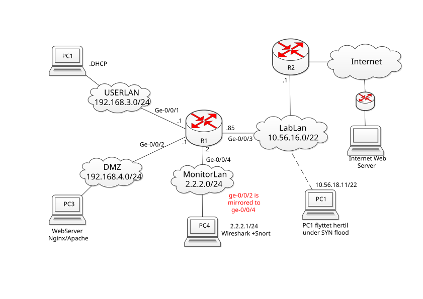

# Assignment 35 – SRX port mirroring og IDS (Snort)

Bygger videre på [Assignment 34](https://github.com/mwsk75996/ass34network). Al trafik ind og ud af ge-0/0/2 (DMZ) spejles til ge-0/0/4, hvor PC4 kører Wireshark og Snort som netværksbaseret IDS.

## HLD

[`HLD.pdf`](HLD.pdf) · [`HLD.svg`](HLD.svg)

## Konfiguration (R1 / SRX-C1)

[`r1-config.json`](r1-config.json): den kørende konfiguration fra SRX-C1 (`show configuration`) i JSON.

Skal den indlæses kommando for kommando, ligger den som set-kommandoer i [`dokumentation/r1-config.set`](dokumentation/r1-config.set).

## Dokumentation

LLD, opsætning af PC4, Snort-regel, optagelser og testresultater ligger i [`dokumentation/`](dokumentation/).
